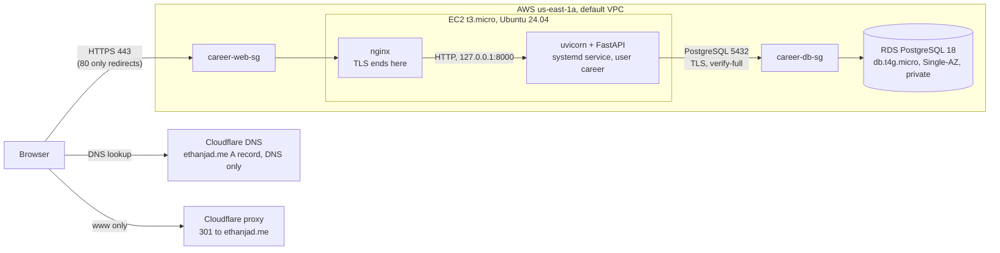

# AWS architecture

The site has run on AWS since the cutover on 2026-11-04. The migration record, with every deviation from the plan and the test evidence, is in [migration-notes.md](../migration-notes.md).

## Request path

Email (Zoho) and analytics (Google) don't pass through AWS.

## Network rules

| Security group | Inbound | Why |
|---|---|---|
| `career-web-sg` | TCP 80 and 443 from anywhere | Web traffic, redirects and certificate renewal for `aws.ethanjad.me` |
| `career-web-sg` | TCP 22 from my laptop's IP only | SSH. If my IP changes, I update this rule in the AWS console |
| `career-db-sg` | TCP 5432 from `career-web-sg` only | Only the app server can reach the database. RDS has no public address |

Port 8000 has no rule and uvicorn listens on loopback only.

## What lives where on the server

| Item | Location |
|---|---|
| Code and Python environment | `/opt/career-platform`, owned by `ubuntu` |
| Service | `deploy/career-platform.service`, installed as `/etc/systemd/system/career-platform.service`, runs as `career` |
| nginx config | `deploy/nginx-career-platform.conf`, installed in `/etc/nginx/sites-available/career-platform` |
| Secrets | `/etc/career-platform/env` (mode `640`, `root:career`), never in Git |
| RDS certificate bundle | `/etc/career-platform/rds-global-bundle.pem` |
| Profile snapshot | `/var/lib/career-platform/profile_snapshot.json`, outside the repo |
| Cloudflare token for renewal | `/etc/letsencrypt/cloudflare.ini` (mode `600`, `root`) |

The service won't start unless `DATABASE_URL` and `ADMIN_SECRET` are set. Without them the app would quietly use SQLite seed data or the default admin secret.

## Certificates

Both are from Let's Encrypt and renew through certbot's timer, which reloads nginx.

| Name | Validation | Depends on |
|---|---|---|
| `ethanjad.me` | DNS, through Cloudflare | The Cloudflare token, limited to DNS edits on this zone |
| `aws.ethanjad.me` | HTTP, through certbot's nginx plugin | Port 80 staying open |

## Who manages what

| Responsibility | Railway | AWS |
|---|---|---|
| OS and security updates | Railway | Me (`unattended-upgrades` on; kernel updates need a manual reboot) |
| nginx and TLS | Railway | Me |
| Restarts after a crash or reboot | Railway | systemd |
| Deploy with a health check | Railway, on push to `main` | `deploy/deploy.sh`, run by hand |
| Database software, patching, backups | Railway ran it; backups were manual | RDS (7-day automated backups) |
| Firewall | Railway | Security groups |
| Outage alerts | None | None yet, an external uptime check is still to add |

## Rebuilding the server

The dated steps are in [the migration plan](superpowers/plans/2026-11-03-aws-ec2-rds-migration.md), Tasks 3 and 5. The database needs no rebuild when the server is replaced, because it's separate.
