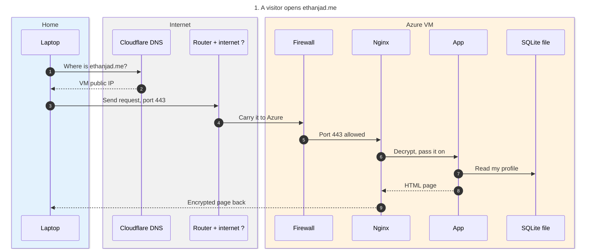
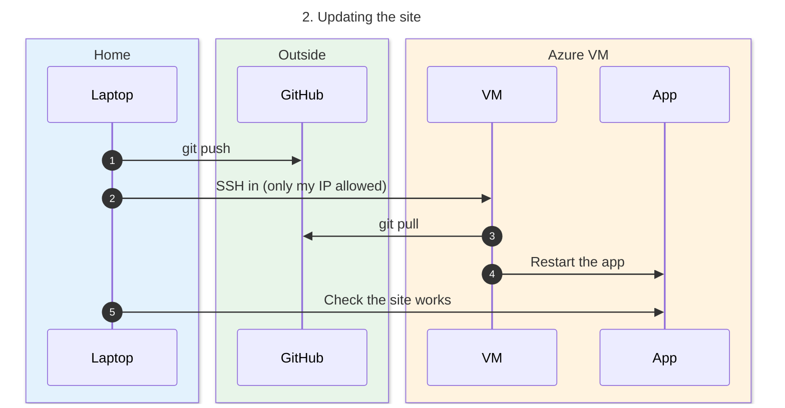
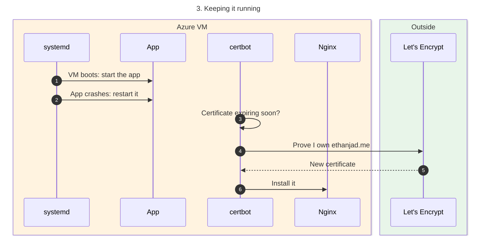
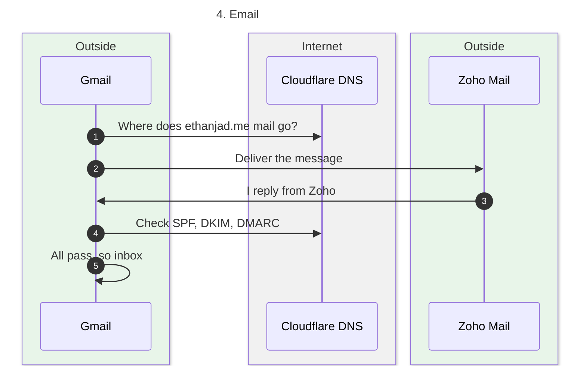
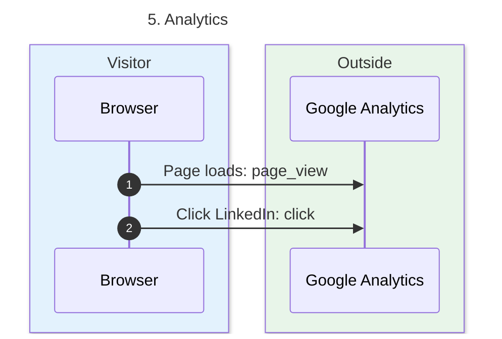

# Azure architecture, step by step

Drafted 2026-10-20 with Claude Code from the repository records. It shows the site as it ran on the Azure VM until the Railway cutover on 2026-10-08.

- **Colors:** blue is home, grey is the internet, orange is Azure, green is outside services.
- **`?`:** marks a detail not recorded in the repo.

Sources: `docs/evidence/ex03.md`, `docs/superpowers/plans/2026-10-01-operate-the-vm.md`, `docs/how-this-site-is-secured.md`, `docs/evidence/ex06.md`.

**Location and ports:**

- **Location:** Azure Sweden Central.
- **Inbound, through the NSG:** TCP 80 and 443 from anyone, and TCP 22 from my IP only.
- **App:** nginx proxied to `127.0.0.1:8000` over the loopback interface.
- **Database:** SQLite, a file opened inside the app, with no network port.
- **Cloudflare DNS:** port 53.

## 1. A visitor opens ethanjad.me

## 2. Updating the site

## 3. Keeping it running

A full reboot test was never run before the VM was deleted on 2026-10-19. See [azure-vm-retired.md](evidence/azure-vm-retired.md).

## 4. Email

## 5. Analytics

Email and analytics never touch the VM. They were added after the move to Railway, and they work the same on either host.
