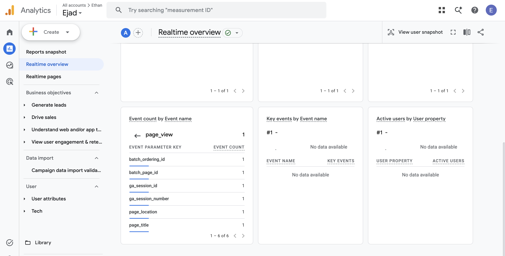
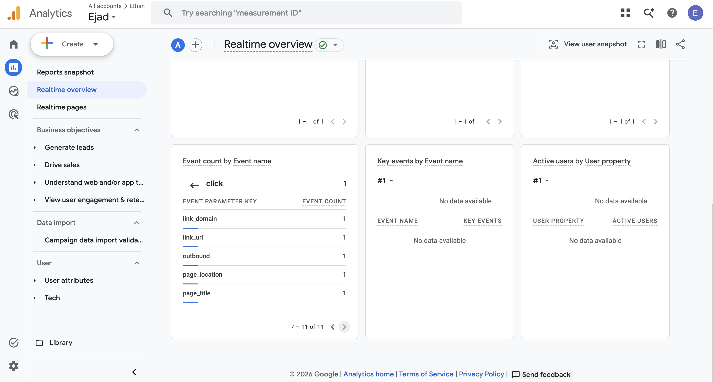

# Exercise 06: Email and Analytics Evidence

## 1. Email tests

Mailbox under test: Zoho Mail on the ethanjad.me domain. Outside mailbox: a personal Gmail account. Times are Pacific (PDT) as Zoho recorded them (Zoho MCP server, `listEmails`).

| Test | Subject | Time (PDT) | Result |
|---|---|---|---|
| Received (Gmail → Zoho) | Re: test hi | 2026-10-18 22:32 | Pass. Arrived in the Zoho Inbox, sender shown as the Gmail account. |
| Replied (Zoho → Gmail) | Re: test hi | 2026-10-18 23:00 | Pass. Sent from the ethanjad.me address. Gmail received it at 23:00:18 (shown in Gmail's Show original). |
| Sent a new message (Zoho → Gmail) | test hi | 2026-10-13 15:06 | Pass. Sent from the ethanjad.me address. It arrived in the Gmail inbox (I checked this in Gmail). |
| **Before MX** (LMU school account → Zoho) | Test NN: what it checks ("Test 00: before setup") | sent 2026-10-13 14:20 | **Delayed, then delivered.** No bounce. It arrived in the Zoho Inbox at 14:41:46, 21 minutes later. |

### What happened to the before-MX message

I sent this message from my LMU school account (Microsoft 365) **before** `ethanjad.me` had any MX records, to see what happens to mail sent to a domain with no mail setup.

| Time (PDT, Oct 13) | Event | Source |
|---|---|---|
| 14:20:20 | Message sent from the LMU account | Outlook Sent Items; Zoho's sent date* |
| 14:36:54 – 14:37:51 | The three MX records (`mx`, `mx2`, `mx3.zoho.com`) created | Cloudflare record `created_on` |
| 14:41:22 | Zoho mailbox `ethan@ethanjad.me` created | Zoho account `accountCreationTime` |
| 14:41:46 | Message arrives in the Zoho Inbox | Zoho `receivedTime` (Zoho MCP search, 2026-10-22) |

\*Zoho's `sentDateInGMT` for this message reads 21:20:20 PDT, exactly 7 hours off. Zoho appears to have applied the time-zone offset twice. 14:20 matches Outlook.

**Why it was delayed and not bounced.**

- **No MX record.** At 14:20 the domain had no MX record. Mail servers then fall back to the domain's own address record (RFC 5321's "implicit MX"). For `ethanjad.me` that was Railway's web server, which doesn't accept mail.
- **A temporary failure.** A sending server treats a server it can't connect to, or one that refuses the connection, as a *temporary* failure. Microsoft 365 therefore kept the message in its queue and retried, instead of bouncing it.
- **Delivery on a retry.** A retry after 14:41 found the new MX records pointing to Zoho, and the mailbox now existed, so the message was delivered.

The send, arrival and setup times above are recorded. The individual retry attempts aren't, because Microsoft's queue isn't visible to me. Zoho's *Show original* on the received message would show its `Received:` timestamps and confirm the hand-off.

**Takeaway.**

- **Not lost:** mail sent while a domain has no MX record is usually *delayed*, not lost. Senders keep retrying for a day or more before giving up with a bounce.
- **But mail can be rejected:** here the MX records went live about 4½ minutes *before* the mailbox existed (14:36:54 vs 14:41:22). A retry in that gap could have been rejected as "user unknown", a permanent failure that bounces immediately. This message still arrived, so either no retry fell in that gap or Zoho answered with a temporary error. The records can't say which.
- **So the order of setup matters:** create the mailbox first, then publish the MX records.

## 2. SPF, DKIM, and DMARC results

Outgoing mail, taken from Gmail's "Show original" on the reply (Re: test hi, 2026-10-18):

Excerpt (addresses shortened to `[sender]@ethanjad.me`):

```
Received: from sender6-of-o52.zoho.com [165.173.180.52] by mx.google.com
  with ESMTPS (version=TLS1_3); Sun, 18 Oct 2026 23:00:18 -0700 (PDT)
Received-SPF: pass (google.com: domain of [sender]@ethanjad.me designates
  165.173.180.52 as permitted sender) client-ip=165.173.180.52;
Authentication-Results: mx.google.com;
  dkim=pass header.i=@ethanjad.me header.s=zmail;
  spf=pass smtp.mailfrom=[sender]@ethanjad.me;
  dmarc=pass (p=NONE sp=NONE dis=NONE) header.from=ethanjad.me
```

Summary: SPF pass (Zoho's sending IP is allowed by the ethanjad.me SPF record), DKIM pass (signed by d=ethanjad.me with selector zmail), DMARC pass (aligned with header.from=ethanjad.me). The DMARC policy is still `p=none`, so it only reports and doesn't block.

The Zoho MCP server shows message bodies but not headers, so the results above come from the outside mailbox.

### The DNS records behind these results

Captured 2026-10-22 00:11 PDT from a public resolver. The DKIM key is shortened here; the full key is in [dns-and-https.md](dns-and-https.md).

```
$ dig +noall +answer @1.1.1.1 ethanjad.me MX
ethanjad.me.		300	IN	MX	10 mx.zoho.com.
ethanjad.me.		300	IN	MX	20 mx2.zoho.com.
ethanjad.me.		300	IN	MX	50 mx3.zoho.com.
$ dig +noall +answer @1.1.1.1 ethanjad.me TXT
ethanjad.me.		300	IN	TXT	"v=spf1 include:zohomail.com ~all"
ethanjad.me.		300	IN	TXT	"zoho-verification=zb86256365.zmverify.zoho.com"
$ dig +noall +answer @1.1.1.1 zmail._domainkey.ethanjad.me TXT
zmail._domainkey.ethanjad.me. 300 IN	TXT	"v=DKIM1; k=rsa; p=MIGfMA0GCSqGSIb3DQEBAQUA…AQAB"
$ dig +noall +answer @1.1.1.1 _dmarc.ethanjad.me TXT
_dmarc.ethanjad.me.	300	IN	TXT	"v=DMARC1; p=none; rua=mailto:ethan@ethanjad.me"
```

| Record | What it does | How it shows up in the headers above |
|---|---|---|
| **MX** `mx` / `mx2` / `mx3.zoho.com` (10/20/50) | Tells other servers where to deliver mail for `@ethanjad.me`. The lowest number is tried first, and the others are backups. Without MX records, senders have nowhere to deliver. | The Gmail → Zoho test arrived in the Zoho inbox. |
| **SPF** `v=spf1 include:zohomail.com ~all` | Lists the servers allowed to send as `ethanjad.me`: whatever Zoho's SPF lists. `~all` asks receivers to treat other senders as suspicious (soft fail). | `spf=pass`. Following the chain, `zohomail.com` includes `spf.zohomail.com`, which contains `ip4:165.173.180.0/24`, and that range covers the sending IP `165.173.180.52` (checked 2026-10-22). |
| **DKIM** `zmail._domainkey` | Publishes the public key for selector `zmail`. Zoho signs each outgoing message with the private key, and receivers check the signature against this key, which proves the message wasn't altered and really came from the domain. | `dkim=pass header.i=@ethanjad.me header.s=zmail` |
| **DMARC** `_dmarc` `p=none` | Requires SPF or DKIM to pass *for the same domain as the visible From address* (alignment), and says what to do when they don't. `p=none` means only monitor and send reports to `rua`, without quarantining or rejecting. | `dmarc=pass (p=NONE …) header.from=ethanjad.me` |
| `zoho-verification` TXT | One-time proof to Zoho that I own the domain. Not used when mail is delivered. | — |

**Next step for DMARC.** After a few weeks of clean reports, move to `p=quarantine` and then `p=reject`. Then mail that fails both checks while claiming to be from `ethanjad.me` gets blocked, not just reported.

## 3. Live site and Google Analytics

- Live site: https://ethanjad.me
- Privacy page: https://ethanjad.me/privacy

GA4 Realtime overview, 2026-10-18 about 11:25 PM PDT: a `page_view` event, then a `click` on the outbound LinkedIn link with the `link_url`, `link_domain` and `outbound` parameters.





### How a browser event reaches GA4

Railway's server never sees analytics. The visitor's browser talks to Google directly:

1. **The page loads.** The browser gets the HTML from Railway. Every page includes `templates/_google_tag.html`, and `test_google_tag_loads_exactly_once_on_every_html_page` checks that it appears once per page.
2. **The browser loads gtag.js.** It fetches `https://www.googletagmanager.com/gtag/js?id=G-1DG579DN36`. That script holds this property's settings, including the **Enhanced Measurement** switches. In the copy served on 2026-10-22: `vtp_enablePageView`, `vtp_enableOutboundClick`, `vtp_enableDownload`, `vtp_enableScroll` and `vtp_enableForm` are all `true`.
3. **gtag sets cookies.** gtag stores two first-party cookies on `ethanjad.me`: `_ga` (a random client ID, `cid`) and `_ga_1DG579DN36` (session ID `sid` and session count `sct`). These are the two cookies named on the privacy page.
4. **The page view is sent.** gtag sends a `page_view` as an HTTPS `POST` to `www.google-analytics.com/g/collect`, the GA4 measurement protocol (`v=2`). The request carries the property ID (`tid`), the page address and title (`dl`, `dt`), and `cid`/`sid`.
5. **Clicks become events.** Enhanced Measurement watches clicks on links. A link to another domain becomes an event named **`click`** with `link_url`, `link_domain`, `outbound=true` and `link_classes`. It's batched and sent a few seconds later to the same endpoint, with the same `cid`/`sid`, so GA4 can tie it to the page view.
6. **GA4 shows it.** GA4 processes the hits. They show in **Realtime** within seconds, and in the standard reports after Google's processing delay.

**Captured on 2026-10-22.** I loaded the live site in headless Chrome and clicked the LinkedIn button. Requests to `google-analytics.com` were answered locally with `204` and the LinkedIn navigation was blocked, so **nothing was sent to GA4** and the report isn't polluted. IDs are from that throwaway browser.

```
07:30:37.251Z LOAD GET https://www.googletagmanager.com/gtag/js?id=G-1DG579DN36
07:30:37.721Z POST www.google-analytics.com/g/collect v=2 | tid=G-1DG579DN36 | en=page_view | dl=https://ethanjad.me/ | dt=Ethan Jad | BBA in Finance and Information Systems & Business Analytics (ISBA) | cid=1364100479.1792654238 | sid=1792654237 | sct=1 | seg=0
07:30:40.226Z cookies on ethanjad.me: _ga_1DG579DN36, _ga
07:30:40.226Z CLICK LinkedIn button
07:30:45.277Z POST www.google-analytics.com/g/collect v=2 | tid=G-1DG579DN36 | en=click | dl=https://ethanjad.me/ | ep.link_url=https://www.linkedin.com/in/ethanjad | ep.link_domain=linkedin.com | ep.outbound=true | ep.link_classes=button button-secondary | cid=1364100479.1792654238 | sid=1792654237 | sct=1 | seg=0 | _et=2551
```

### Why the outbound click matters

The site's job is to get a recruiter to take the next step, and the next step usually happens **somewhere else**: my LinkedIn or GitHub.

- **Page views only count visits.** They say how many people arrived, not whether anyone acted.
- **The server can't see it.** When a visitor follows the LinkedIn link, their browser leaves for `linkedin.com`, and Railway gets no request for that click. Only a script in the page can see it.
- **The click event can.** It records *which* external link was used (`link_url`), *where* on the page it was (`link_classes` tells the hero buttons from footer links), and in *which* visit (`sid`).

That makes it the closest thing this site has to a conversion: visits that led to a profile click.

### What the checks prove, and what they don't

**What they prove:**
- **The whole path works with a real browser and the real property.** The Realtime screenshots (2026-10-18) show GA4 *received* a `page_view` and an outbound `click` with `link_url`, `link_domain` and `outbound`. That means the tag is on the live page, the measurement ID is right, and Enhanced Measurement's outbound clicks are on.
- **What exactly the browser sends.** The 2026-10-22 capture shows the property ID, the page, the click's target, and the shared visitor and session IDs that tie the click to its page view. It also shows that only the two documented cookies are set.
- **The tag isn't duplicated or missing.** The test checks it loads exactly once on every HTML page, so page views aren't double-counted or dropped.

**What they don't prove:**
- **The counts aren't complete.** Content blockers, Google's opt-out add-on and disabled JavaScript all stop the tag, so real traffic is higher than GA4 reports.
- **Some hits may be bots.** The site has no consent banner and no bot filtering of its own (GA4 filters only known bots).
- **Realtime isn't the standard reports.** Realtime proves arrival, while the standard reports apply processing, thresholds and delays.
- **The capture tested the browser side only.** It deliberately didn't send anything, so on its own it doesn't show that GA4 received those two hits. The 2026-10-18 screenshots cover that.
- **IP storage is Google's word.** That GA4 doesn't store IP addresses is Google's statement, which the privacy page notes I can't verify.
