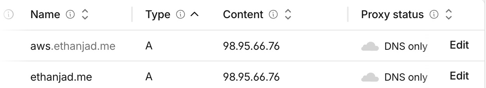
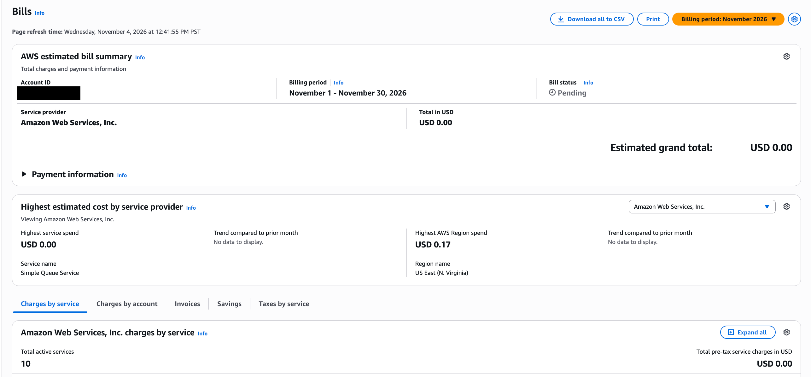

# Exercise 07: AWS migration results

The architecture diagram is in the README: [Architecture](../../README.md#architecture). The full record, with all 22 deviations from the plan, is in [migration-notes.md](../../migration-notes.md). This repo is public, so `<EIP>` stands for the server's Elastic IP.

## 1. Architecture decision

I chose one EC2 `t3.micro` with one private, Single-AZ RDS PostgreSQL `db.t4g.micro` in `us-east-1`, rejecting PostgreSQL on the same server (about $10/mo, but one failure takes down the app and the data together) and Lambda with API Gateway and RDS (about $15/mo, but it needs code changes and has cold starts), and I accepted the highest cost of the three (about $27/mo), running the server myself, and no redundancy if `us-east-1a` fails.

## 2. Backup record

| Item | Record |
|---|---|
| Backup date | 2026-11-04 09:25:54 UTC, the final Railway export before the cutover. Rehearsal export: 08:16 UTC the same day. |
| Backup file | `railway-final-20261104T092554Z.dump`, 13,900 bytes, SHA-256 `bb5096a8…6d2109`. Kept on my laptop, outside the repo. |
| Restore test: before anything moved | **Pass.** At 08:16 UTC, the rehearsal export was restored from EC2 with `pg_restore` 18.6 into an empty RDS database. All 7 tables (row counts and MD5 hashes), 5 sequences and 35 constraints matched Railway. |
| Restore test: final export | **Pass.** It was restored into an emptied RDS database during the cutover and matched Railway. On 2026-11-04 at about 20:30 UTC, I also restored the same file into a throwaway local PostgreSQL 18.6: exit `0`, in under a second, with 7 tables, 5 sequences and 35 constraints. |
| Data loss I accept | **Up to 5 minutes**, the usual gap for RDS point-in-time recovery. Content changes only when I edit it through the admin API, so I could re-enter anything lost. |
| Recovery time I accept | **Up to 4 hours after I notice the failure.** A GitHub Actions check now tests the site about every 15 minutes, but I haven't tested a failure alert, so noticing could take longer. If only the database fails, visitors see the saved profile with a `503` until it's back. |
| Not tested | Restoring an RDS automated backup or snapshot to a new instance, so the 4 hours is a target, not a measured time. The next step is one timed restore, if the instructor is fine with the small extra cost. |

## 3. Section 10 verification: `aws.ethanjad.me` over HTTPS

Tests from before the cutover ran on 2026-11-04 between about 08:52 and 09:26 UTC. "Re-run" means I repeated the test from the laptop at about 20:30 UTC.

| What I tested | Evidence | Result |
|---|---|---|
| DNS | `aws.ethanjad.me` is `A <EIP>`, DNS only (Cloudflare CLI). `1.1.1.1` and `8.8.8.8` both return `<EIP>`. Re-run. | Pass |
| HTTPS certificate | Let's Encrypt `YE1`, covers `aws.ethanjad.me`, expires 2027-02-02, `curl` verify result `0`. Re-run. | Pass |
| HTTP redirects to HTTPS | `http://…/privacy?x=1` returns `301` to `https://…/privacy?x=1`. Re-run. | Pass |
| Certificate renewal | `certbot renew --dry-run` succeeded for both certificates. The first `ethanjad.me` try hit a temporary Let's Encrypt "Service busy", and the retry passed. | Pass |
| Pages | `/`, `/privacy`, `/healthz` and `/resume.pdf` return `200`, and a missing page returns `404`. Re-run. | Pass |
| Same content as Railway, before the cutover | Homepage identical after removing host names, PDF byte-identical, all 13 database comparison lines match. | Pass |
| Admin login | No secret, a wrong secret and `change-me` all return `401`. Re-run. | Pass |
| Admin writes on RDS | Create, update and delete through the API showed on the page and were undone. Railway never got the row. | Pass |
| Ports on the server | `80` and `443` are open. `8000` and `5432` are closed from outside. Re-run. | Pass |
| Database not public | `describe-db-instances` showed `PubliclyAccessible=false`, Single-AZ, `db.t4g.micro` on 2026-11-04. Not re-run, because the AWS session had expired. | Pass |
| Crash, reboot, bad deploy | The service came back after `kill -9` and a reboot. A deliberately broken deploy rolled back and exited `1`. | Pass |
| Sudden database outage | Simulated with a firewall rule. Later requests return `503` with the profile, and the site recovers by itself. **The first request hung and got `504` after 60 seconds.** Tried: `tcp_user_timeout=5000` cut this to about 12 seconds on a test copy, and I applied it to the live server. Next step: retest on the live app in a quiet period. | Fail, fix not verified live |
| Unknown table in an admin request | **First failed:** with a valid secret, an unknown table returned `500` instead of a clean error. Visitors couldn't trigger it, because it needs the secret. Fixed in `8f26c3f` with automated tests, then deployed. On the live server on 2026-11-04, a valid secret with an unknown table returned `404`, and no secret still returned `401`. | Pass after fix |
| Padlock in a real browser | I opened the site in a real browser and saw the padlock. Certificate also checked with `curl` and `openssl`. | Pass |
| A person clicking through on laptop and phone | I clicked through the site myself on a laptop and a phone. Headless Chrome screenshots at 1280 and 500 px wide also looked correct. | Pass |
| LinkedIn link | I opened the link myself and it worked. LinkedIn returns `999` to automated requests, so a script can't confirm it. The other 6 external links returned `200`. | Pass |
| Google Analytics | I checked Google Analytics myself and visits arrive. The tag is also on the page. | Pass |
| Small load test | On 2026-11-04 from my laptop: 300 requests to `https://ethanjad.me/` (the same server), 5 at a time. 0 failed, median 352 ms, slowest 550 ms, no errors in the service log. This is a small test, not a capacity limit. | Pass |
| Real RDS restart or failover | Not run. The outage above was simulated. | Not verified |

## 4. Cutover status

**Done.** `ethanjad.me` moved to AWS on **2026-11-04 at 09:26 UTC**, as an `A` record to `<EIP>`, DNS only. Cloudflare's `modified_on` for that record is `2026-11-04T09:26:42Z`, and the site now answers from nginx on AWS. At about 20:30 UTC, the homepage on `ethanjad.me` matched `aws.ethanjad.me` line for line after host names were aligned, and `www` still returned `301` to the apex.

## 5. Cost

**Estimate:** about **$26.82/mo** from AWS's public `us-east-1` prices on 2026-11-03, in line with section 6's "about $26 a month": EC2 $7.59, disk $1.60, public IP $3.65, RDS $11.68, RDS storage $2.30. This assumes backups and data transfer stay in their free allowances, and doesn't count credits.

**Billing page now:** on 2026-11-04 at 12:41 PM PST, the Bills page for November 2026 showed an estimated grand total of **USD 0.00**, with status Pending and USD 0.17 listed as the highest AWS Region spend (US East, N. Virginia). That's about a day of running, so it can't confirm the estimate yet. I blacked out the account ID in the screenshot.

**Credits:** the total is $0 because credits are covering usage. The Credits page the same day showed $0.16 estimated as used and $139.84 estimated as remaining, from three active credits totaling $140 that expire 2027-10-28. At the estimated rate, they last a little over 5 months, so real charges would start around April 2027. When the semester ends, I'll decide whether to keep paying, move to a cheaper host, or delete the site.

**Restriction:** on 2026-11-03, the account's Free plan refused to create the database with 7-day RDS backups (`FreeTierRestrictionError`). I had log-in difficulties during the class session and finished the in-class work on my own. I upgraded to the Paid plan, about $27/mo by my estimate, and the database was then created. **I did not ask the instructor before upgrading, which the assignment required.** The account is charged once the credits run out instead of being protected by the Free plan. The `isba-student` user can't read billing, which is why this figure comes from the owner's page.
