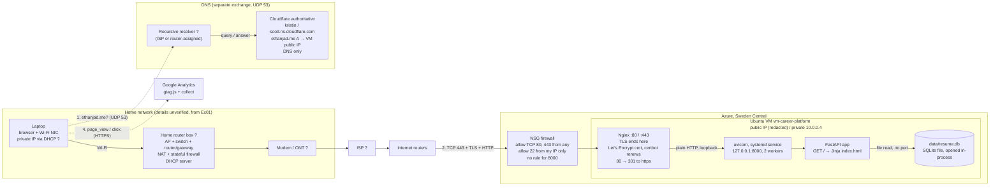
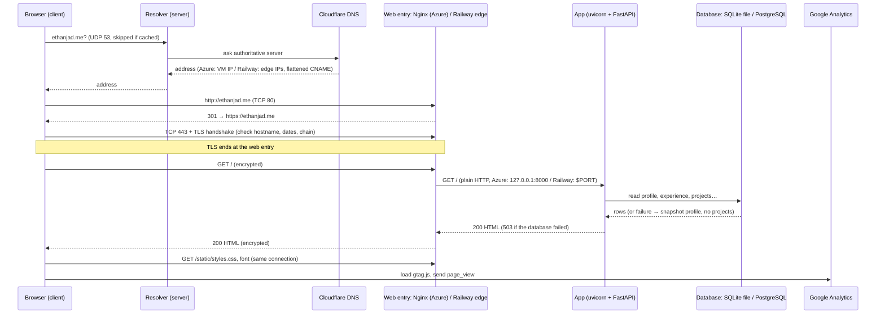
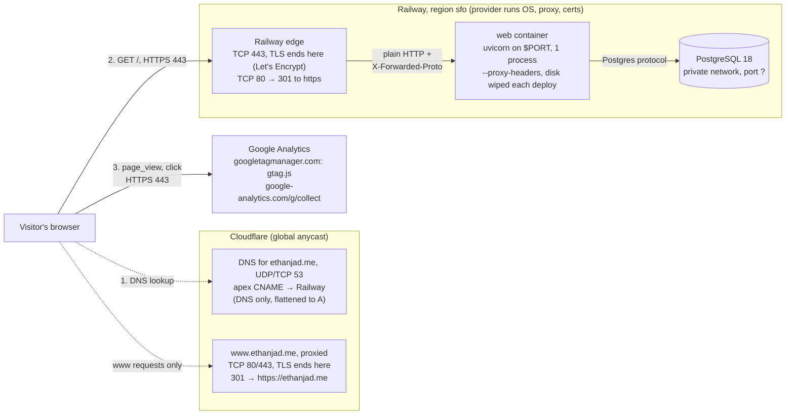
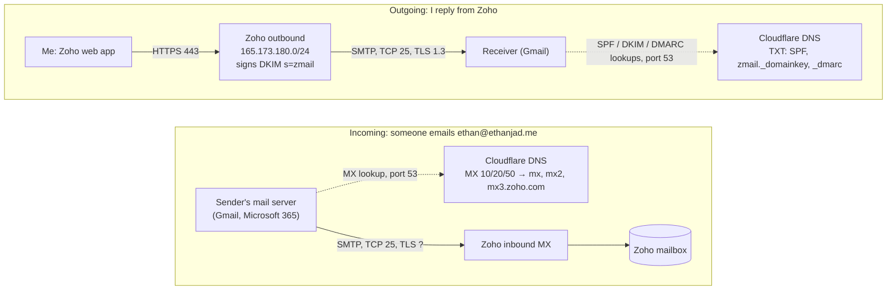

# Request path: entering ethanjad.me in a browser

Drafted 2026-10-20 with Claude Code from the repository records, as a study aid. Labels ending in `?` are not recorded in this repository (home network details come from Exercise 01) and are unverified.

- The Azure diagram shows the site as it ran until the Railway cutover on 2026-10-08. Email and analytics were added after the cutover, so section 3 shows them.
- On Railway, `start.sh` runs one uvicorn process. `--workers 2` was only on Azure.
- On a database failure the app answers 503. The profile comes from the saved snapshot and Projects shows "temporarily unavailable" ([evidence](evidence/db-failure-503.md)).

## 1. Azure: hardware and services

## 2. Order of events (either host)

## 3. Railway today: web, data, email and analytics

Locations:

- **Railway:** the web service and Postgres. The Oct 8 deployment manifests list region `sfo`.
- **Cloudflare:** DNS and the `www` redirect, on its global anycast network.
- **Zoho Mail:** US data centre (Zoho account country `us`).
- **Google Analytics:** Google's servers.

Ports are the ones recorded or observed. `?` marks values not recorded in this repo.

### 3a. Web pages and analytics

### 3b. Email (Zoho Mail, US)

**What never touches Railway:**

- **Email.** It goes between mail servers and Zoho, steered by Cloudflare DNS.
- **Analytics.** The visitor's browser sends it straight to Google.

Railway only serves the web pages and holds the database.
