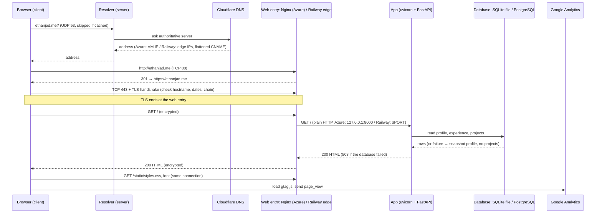
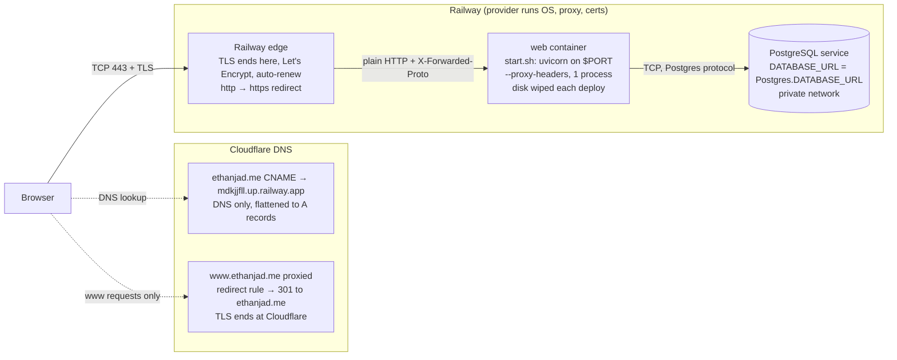

# Request path: entering ethanjad.me in a browser

Drafted 2026-10-20 with Claude Code from the repository records, as a study aid. Labels ending in `?` are not recorded in this repository (home network details come from Exercise 01) and are unverified.

- The Azure diagram shows the site as it ran until the Railway cutover on 2026-10-08.
- On Railway, `start.sh` runs one uvicorn process. `--workers 2` was only on Azure.
- On a database failure the app answers 503. The profile comes from the saved snapshot and Projects shows "temporarily unavailable" ([evidence](evidence/db-failure-503.md)).

## 1. Azure: hardware and services

## 2. Order of events (either host)

## 3. What changes on Railway

